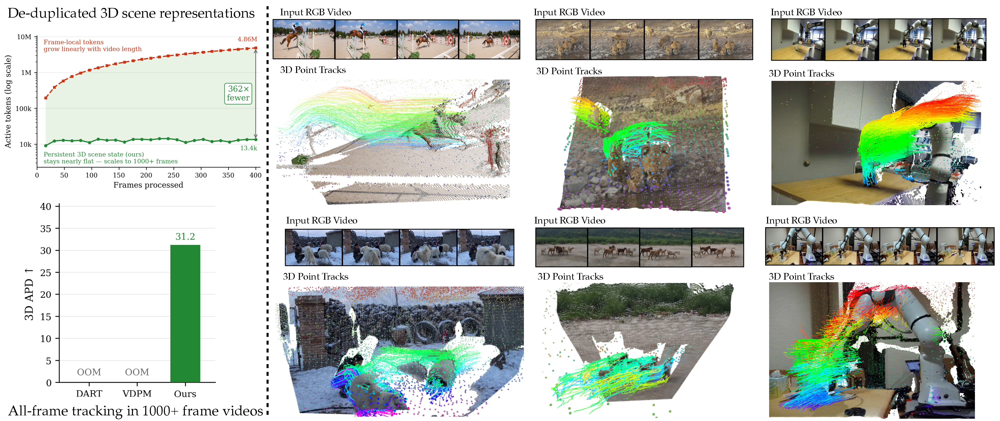

<div align="center">

# TrackEverything

### Long Horizon Dense Tracking via De-Duplicating 3D Scene Representations

[Ayush Jain](https://ayushjain1144.github.io/)<sup>1</sup> ·
[Sreeharsha Paruchuri](https://sreeharshaparuchur1.github.io/)<sup>1</sup> ·
[Ishita Gupta](https://gupta-ish.github.io/)<sup>1</sup> ·
[Fan Zhang](https://scholar.google.com/citations?user=64vtwkoAAAAJ&hl=en)<sup>2</sup> ·
[Tanner Schmidt](https://tschmidt23.github.io/)<sup>2</sup> ·
[Jakob Engel](https://jakobengel.github.io/)<sup>2</sup> ·
[Katerina Fragkiadaki](https://www.cs.cmu.edu/~katef/)<sup>1</sup> ·
[Adam W. Harley](https://adamharley.com/)<sup>2</sup>

<sup>1</sup>Carnegie Mellon University · <sup>2</sup>Meta

[Project Page](https://trackeverything.github.io/) · [Paper](https://arxiv.org/abs/2609.30222) · [Model](https://huggingface.co/katefgroup/TrackEverything) · [Demo](https://huggingface.co/spaces/hugging-apps/trackeverything)

<br>



</div>

## Updates

- **Oct 2026**: Added experimental multiview inference. See [Multiview Inference](docs/multiview_inference.md).

## Overview

TrackEverything tracks dense 3D points across long video sequences. Given RGB frames along with depth and camera poses, it builds and maintains a persistent, de-duplicated 3D scene representation. Trajectories are refined in 3D across temporal windows, and points are classified as static or dynamic.

If depth and camera poses are not provided, they are estimated on the fly with feedforward 3D reconstruction models like [VGGT-Ω](http://vggt-omega.github.io/).

**Contents:** [Installation](#installation) · [Inference](#inference-demopy--demo_hfpy) · [Dataset Preparation](#dataset-preparation) · [Evaluation](#evaluation) · [Training](#training) · [Documentation](#documentation) · [License](#license) · [Citation](#citation)

---

## Installation

Tested on Linux with Python 3.10, PyTorch 2.8, and CUDA 12.9.

```bash
git clone https://github.com/ayushjain1144/trackeverything.git
cd trackeverything

conda create -n trackeverything python=3.10 -y
conda activate trackeverything

pip install torch==2.8.0 torchvision==0.23.0 --index-url https://download.pytorch.org/whl/cu129
pip install torch_scatter -f https://data.pyg.org/whl/torch-2.8.0+cu129.html
pip install omegaconf hydra-core ipdb einops rich transformers wandb tqdm tensorboard iopath \
  numpy fsspec torchinfo h5py imageio imageio-ffmpeg matplotlib opencv-python viztracer pillow scipy \
  opt-einsum python-box line-profiler typed-argument-parser plyfile av rerun-sdk accelerate \
  huggingface_hub

# The repository directory is the package trackeverything; add its parent directory to PYTHONPATH:
export PYTHONPATH="$(dirname "$PWD"):$PYTHONPATH"
```

Inference needs nothing further. **Training** additionally requires the deformable-attention
CUDA extension, which backs the gradient of the DINOv3 ViT adapter:

```bash
cd libs/ops
FORCE_CUDA=1 TORCH_CUDA_ARCH_LIST="8.0;8.6;8.9;9.0" pip install --no-build-isolation .
cd ../..
```

Set `TORCH_CUDA_ARCH_LIST` to the architectures you train on, and `CUDA_HOME` to a CUDA
toolkit matching the Torch build (12.9 above) if `nvcc` is not already on `PATH`.

---

## Inference (`demo.py` & `demo_hf.py`)

To try the model on your own video without installing anything, use the hosted [demo](https://huggingface.co/spaces/hugging-apps/trackeverything).

We provide two entry points for inference depending on your workflow:
- **`demo.py`**: Runs tracking on a video and visualizes the results (Rerun 3D viewer, 2D overlay MP4 videos, optional Weights & Biases logging).
- **`demo_hf.py`**: Python API and lightweight CLI to run inference and extract/save track tensors without visualization dependencies.

### 1. Visual Demo (`demo.py`)

Run tracking and log 3D scene tracks to [Rerun](https://rerun.io/):

```bash
python -m trackeverything.demo --video path/to/video.mp4
```

This downloads weights from Hugging Face, estimates camera poses and depth using VGGT-Ω (use `--geometry_backend pi3` to switch), and saves an `output.rrd` file under `outputs/inference/<timestamp>/`. You can view it by running:

```bash
rerun outputs/inference/<timestamp>/output.rrd
```

Useful flags for `demo.py`:

| Flag | Description |
| --- | --- |
| `--geometry_backend` | Backend for depth and camera estimation: `vggt_omega` (default) or `pi3`. |
| `--start_frame`, `--max_frames`, `--frame_stride` | Subsample or temporally crop the video. |
| `--use_wandb true` | Log videos and visualizations directly to Weights & Biases. |

### 2. Python API (`demo_hf.py`)

To integrate TrackEverything into your own pipeline:

```python
from trackeverything.demo_hf import TrackEverything

# Load model from Hugging Face (or local path)
model = TrackEverything.from_pretrained("katefgroup/TrackEverything", device="cuda")

# Run inference (depth and camera poses estimated automatically)
out = model.infer(video="path/to/video.mp4")

# Compact scene tracks: scales linearly with sequence length O(T)
tracks = out.tracks()
print(tracks.coords.shape)        # (N, T, 3) 3D world coordinates
print(tracks.visibs.shape)        # (N, T) visibility logits
print(tracks.dyn_logits.shape)    # (N, T) static vs dynamic logits
print(tracks.src_time.shape)      # (N,) birth frame index for each point
print(tracks.cell_to_token.shape) # (T, H', W') spatial token assignment

# Expand to per-pixel dense tracks (1, T_src, H', W', T_tgt, 3) on demand:
dense_coords, dense_visibs, dense_dyn = tracks.to_dense()
```

### 3. Tracking Specific Query Points

To track user-specified 2D points in addition to tracking every pixel, pass a `(N, 3)` numpy array of `[frame_idx, x, y]` points:

```bash
python -m trackeverything.demo_hf \
  --video path/to/video.mp4 \
  --mode sparse \
  --query_points path/to/query_points.npy
```

Query points never get merged with other points, so they can sometimes retain higher resolution than the dense tracks. Please see the paper for more details.

### 4. Supplying Custom Depth and Cameras

If you already have depth maps and camera poses, pass them to bypass Pi3 / VGGT-Ω:

```bash
python -m trackeverything.demo \
  --video path/to/video.mp4 \
  --depths_dir path/to/depths_folder \
  --intrinsics_path path/to/intrinsics.npy \
  --extrinsics_path path/to/extrinsics.npy
```

### 5. Multiple Synchronized Cameras

Pass one video per camera, separated by commas. One 2D track video is written
per camera:

```bash
python -m trackeverything.demo_multiview \
  --video cam0.mp4,cam1.mp4,cam2.mp4,cam3.mp4 \
  --save_dense_2d_video
```

This is experimental and inference only. See [Multiview Inference](docs/multiview_inference.md)
for the details and for multiview evaluation.

For signed-log voxelization, memory compression, and other advanced options, see the [Advanced Usage Guide](docs/advanced_usage.md).

---

## Dataset Preparation

Training TrackEverything uses Point Odyssey, Dynamic Replica, and CoTracker3 Kubric. Evaluation is performed on Kubric, Dynamic Replica, and the TAPVid3D benchmark (ADT, Panoptic Studio, DriveTrack).

Dataset paths are configured centrally in [`configs/paths.yaml`](configs/paths.yaml):

```yaml
kubric_root: /path/to/kubric
cotracker3_kubric_root: /path/to/CoTracker3_Kubric
pod_root: /path/to/point_odyssey
dynamic_replica_train_root: /path/to/dynamic_replica
dynamic_replica_val_root: /path/to/dynamic_replica
tapvid3d_root: /path/to/tapvid3d
panoptic_multiview_root: /path/to/panoptic-multiview
dexycb_multiview_root: /path/to/dex-ycb-multiview
```

For complete instructions on dataset setup, see:

👉 **[Dataset Preparation & Processing Guide](docs/data_processing.md)**

---

## Evaluation

Download the trained model checkpoint:

```bash
mkdir -p checkpoints
wget -O checkpoints/model.pth https://huggingface.co/katefgroup/TrackEverything/resolve/main/model.pth
```

Run evaluation using `scripts/main.sh` with `eval_only=true`. Specify target datasets with `eval_datasets`:

```bash
bash scripts/main.sh \
  experiment_id=eval_release \
  eval_only=true \
  wandb.enable=false \
  train.checkpoint=checkpoints/model.pth \
  train.resume_load_optimizer=false \
  eval_datasets='["adt_minival_megasam","pstudio_minival_megasam","drivetrack_minival_megasam"]'
```

### Available Evaluation Sets

| Dataset | Ground-Truth Geometry | Estimated Geometry |
| --- | --- | --- |
| **Kubric** | `kubric_eval` | — |
| **Dynamic Replica** | `dynamic_replica` | — |
| **Point Odyssey** | `pod_eval` | — |
| **TAPVid3D ADT** | `adt_minival_gt`, `adt_full_gt` | `adt_minival_megasam`, `adt_full_megasam` |
| **TAP-Vid3D Panoptic Studio** | - | `pstudio_minival_megasam`, `pstudio_full_megasam` |
| **TAP-Vid3D DriveTrack** | - | `drivetrack_minival_megasam`, `drivetrack_full_megasam` |
| **Multiview Panoptic Studio** | `multiview_panoptic_studio_eval` | — |
| **Multiview DexYCB** | `multiview_dexycb_eval` | — |

The two multiview sets are run with [`scripts/eval_multiview.sh`](scripts/eval_multiview.sh),
which sets the flags they need:

```bash
CKPT=checkpoints/model.pth DATASET=panoptic VIEWS=4 FRAMES=16 \
  bash scripts/eval_multiview.sh
```

See [Multiview Inference](docs/multiview_inference.md).

---

## Training

To train on 8 GPUs:

```bash
ANNOTATOR_NAME=vggt_omega NUM_GPUS=8 bash scripts/main.sh \
  experiment_id=track_everything_release \
  train.eval_freq=8000 \
  train.save_freq=8000 \
  train_datasets='["pod_train","dynamic_replica_train","kubric_long"]' \
  eval_datasets='["kubric_eval","dynamic_replica","pstudio_minival_megasam","adt_minival_megasam","drivetrack_minival_megasam"]' \
  +criterion.query_loss_weight=5.0 \
  train.lr=1e-4 \
  +train.length_schedule.enabled=true \
  +train.length_schedule.pattern=alternate \
  +train.length_schedule.start_with_long=true \
  +train.length_schedule.short_frames=32 \
  +train.length_schedule.long_frames=64 \
  +train.length_schedule.short_warmup_frames=0 \
  +train.length_schedule.long_warmup_frames=32 \
  +train.dataset_overrides.strides='[1,2]' \
  train.dataset_overrides.frames_per_sample=64
```

Training alternates between 32- and 64-frame temporal windows. For the first 100k iterations, we only train on 32-frame windows: you can do this by setting `+train.length_schedule.enabled=false`.

---

## Documentation

Detailed documentation and guides are available in [`docs/`](docs/):

- **[Dataset Preparation & Processing](docs/data_processing.md)**: Dataset paths, fast annotation splitting, precomputing geometry, and complete documentation on the Point Odyssey annotation fixes.
- **[Advanced Usage Guide](docs/advanced_usage.md)**: Voxelization modes (`uniform` vs. `signedlog`), memory compression for ultra-long videos, custom geometry, and Hydra overrides.
- **[Multiview Inference](docs/multiview_inference.md)**: Running the tracker on several synchronized cameras, and multiview evaluation.
- **[Frequently Asked Questions (FAQ)](docs/faq.md)**: Troubleshooting environment issues, memory optimization, coordinate conventions, and common questions.

---

## Acknowledgements

This codebase benefits from [TAPIP3D](https://github.com/zbww/tapip3d), [CoTracker](https://github.com/facebookresearch/co-tracker), [DINOv3](https://github.com/facebookresearch/dinov3), [Pi3](https://github.com/yyfz/Pi3), and [VGGT-Ω](http://vggt-omega.github.io/). We thank the authors for releasing their code and models.

---

## License

This project is licensed under the [Creative Commons Attribution-NonCommercial 4.0 International License (CC BY-NC 4.0)](https://creativecommons.org/licenses/by-nc/4.0/). You may share and adapt the material for non-commercial purposes with attribution. See [LICENSE](LICENSE) for details.

---

## Citation

```bibtex
@misc{jain2026trackeverythinglonghorizondense,
      title={TrackEverything: Long Horizon Dense Tracking via De-Duplicating 3D Scene Representations},
      author={Ayush Jain and Sreeharsha Paruchuri and Ishita Gupta and Fan Zhang and Tanner Schmidt and Jakob Engel and Katerina Fragkiadaki and Adam W. Harley},
      year={2026},
      eprint={2609.30222},
      archivePrefix={arXiv},
      primaryClass={cs.CV},
      url={https://arxiv.org/abs/2609.30222},
}
```
